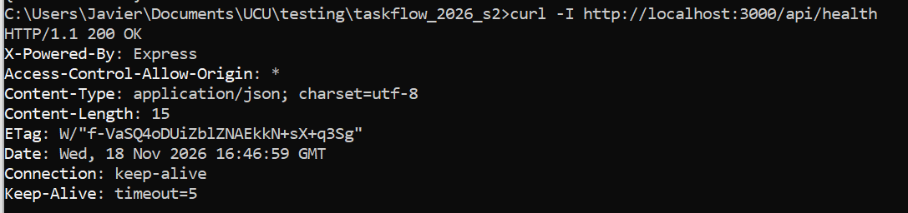
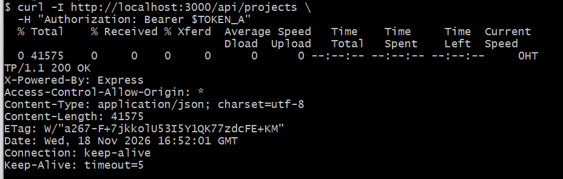
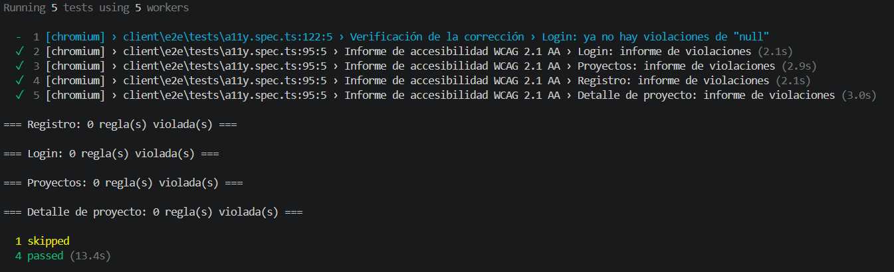
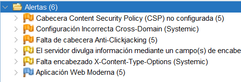

# Reporte de Seguridad y Accesibilidad

## Headers de seguridad

| Header | ¿Aparece? | Qué significa si falta (o si sobra) |
|---|---|---|
| `Content-Security-Policy` | No | Mitiga XSS limitando de dónde se ejecuta JavaScript |
| `Strict-Transport-Security` | No | Fuerza HTTPS. Solo tiene efecto sobre HTTPS, pero igual es configuración faltante para producción |
| `X-Frame-Options` | No | Evita clickjacking (embeber la app en un iframe malicioso) |
| `X-Content-Type-Options` | No | Evita que el navegador "adivine" el tipo de contenido (`nosniff`) |
| `X-Powered-By` | Sí | Si aparece, **sobra**: revela la tecnología del servidor |
| `Access-Control-Allow-Origin` | Sí | Si vale `*`, cualquier sitio web puede llamar a la API desde un navegador |

### Evidencia

## Análisis de dependencias

El comando `npm audit` arrojó una sola vulnerabilidad.

| | |
|---|---|
|**Aspecto** |	Vulnerabilidad: shell-quote |
|**Severidad** |	CRITICAL |
|**Tipo de dependencia** |	Desarrollo y test. No aparece entre las dependencias de producción, ya que npm audit --omit=dev no detectó vulnerabilidades. |
| **Problema** | Posible inyección de comandos (command injection) mediante la función quote(). |
| **¿Tiene arreglo disponible?**	| Sí. npm audit indica que existe una solución mediante npm audit fix. |
| **¿Es un cambio breaking?** |	No se indica que sea necesario un cambio incompatible. npm audit fix intenta resolver las vulnerabilidades mediante actualizaciones compatibles con las restricciones de versiones existentes. |

## Hallazgos de seguridad

Se realizaron las siguientes pruebas y no se encontraron problemas de seguridad:

- Acceder a proyecto con token de usuario que no es miembro del proyecto
- Inyección SQL en login y buscador de tareas
- XSS almacenado al crear tarea
- Acceso con token sin firma.

## Control de seguridad verificado

| | |
|---|---|
| **Qué se probó** | Acceder a proyecto con token de usuario que no es miembro del proyecto |
| **Resultado esperado** | No se permite acceder al proyecto |
| **Resultado obtenido** | No se permite acceder al proyecto |
| **Qué parte del código lo explica** | Función *list* en archivo *projects.controller.ts* de server |

| | |
|---|---|
| **Qué se probó** | Acceder a proyectos con token sin firma |
| **Resultado esperado** | No se permite acceder y se obtiene error de autorización |
| **Resultado obtenido** | No se permite acceder y se obtiene error de autorización |
| **Qué parte del código lo explica** | Función *authenticate* en archivo *middleware/auth.ts* de server |

## Hallazgos de accesibilidad (Axe-core)

No se han encontrado vulnerabilidades o bug mediante el test con axe-core

>[!NOTE]
> Se altero el archivo de a11y.spec debido a que usaba endpoint obsoletos

Debido a que no hubo hallazgo a la vista se uso el comando `npx playwright test a11y --project=chromium --reporter=htm` para guardar el reporte. Se puede usar el comando `npx playwright show-report` para ver el html del reporte

### Hallazgo de accesibilidad (revisión manual)

axe-core no detecta este problema porque un título presente pero no descriptivo no viola ninguna de las reglas automáticas.

| | |
|---|---|
| *ID*| ACC-01 |
| *SC WCAG 2.1* | 2.4.2 Page Titled |
| *Nivel* | A |
| *Principio POUR* | Operable |
| *Cómo se detectó* | Revisión manual |
| *Vista afectada* | Todas (Login, Proyectos, Detalle de proyecto, Miembros y Detalle de tarea) |
| *Descripción del fallo* | La aplicación es una SPA con un único `<title>TaskFlow</title>` en `client/index.html`, y ninguna página lo actualiza (no hay `document.title` en `client/src`). Al navegar entre vistas, la pestaña del navegador siempre dice «TaskFlow», por lo que un usuario de lector de pantalla, o con varias pestañas abiertas, no puede saber en qué pantalla está. |
| *Fix propuesto* | Actualizar `document.title` en cada página con un título descriptivo, por ejemplo «Ingresar — TaskFlow», «Proyectos — TaskFlow» o «\<nombre del proyecto\> — TaskFlow», y verificarlo con un test de Playwright (`await expect(page).toHaveTitle(...)`). |

## OWASP ZAP

Se ejecuto un escaneo automatico contra la app utilizando la applicacion de escritorio de OWASP ZAP

El reporte completo está en el html `zap-5173.html` 

### Tabla de las alertas
|#|	Alerta|	Riesgo|	Instancias|	URLs afectadas|	CWE / WASC|	Plugin|	Solución propuesta|
|---|---|---|---|---|---|---|---|
|1|	Cabecera Content Security Policy (CSP) no configurada|	Medio|	5|	/, /@vite, /robots.txt, /sitemap.xml, /src|	693 / 15|	10038|	Configurar la cabecera Content-Security-Policy en el servidor|
|2|	Configuración incorrecta Cross-Domain|	Medio|	Systemic|	/, /@vite/client, /robots.txt, /sitemap.xml, /src/main.tsx|	264 / 14|	10098|	Restringir Access-Control-Allow-Origin a dominios concretos o quitar los headers CORS. Evidencia: Access-Control-Allow-Origin: *|
|3|	Falta de cabecera Anti-Clickjacking|	Medio|	5|	/, /@vite, /robots.txt, /sitemap.xml, /src|	1021 / 15|	10020|	Enviar X-Frame-Options (p. ej. SAMEORIGIN) o frame-ancestors en la CSP|
|4|	El servidor divulga información mediante X-Powered-By|	Bajo|	1|	/api/health|	497 / 13|	10037|	Suprimir el header. Evidencia: x-powered-by: Express|
|5|	Falta encabezado X-Content-Type-Options|	Bajo|	Systemic|	/, /@vite/client, /robots.txt, /src/main.tsx|	693 / 15|	10021|	Enviar X-Content-Type-Options: nosniff|
|6|	Aplicación Web Moderna|	Informativo|	5|	/, /@vite, /robots.txt, /sitemap.xml, /src|	n/a|	10109|	Ninguna: ZAP solo avisa que es una SPA|

## Hallazgos de seguridad: severidad CVSS 3.1

Evidencia: tabla de headers (curl contra la API) y reporte `zap-5173.html` (X-Powered-By).
Rangos de severidad: LOW 0.1–3.9 · MEDIUM 4.0–6.9 · HIGH 7.0–8.9 · CRITICAL 9.0–10.

| ID | Hallazgo | Severidad | CVSS 3.1 | Vector | Remediación |
|---|---|---|---|---|---|
| SEC-01 | CORS abierto (`Access-Control-Allow-Origin: *`) | MEDIUM | 4.3 | [AV:N/AC:L/PR:N/UI:R/S:U/C:L/I:N/A:N](https://www.first.org/cvss/calculator/3.1#CVSS:3.1/AV:N/AC:L/PR:N/UI:R/S:U/C:L/I:N/A:N) | `cors({ origin: <dominio del frontend> })` |
| SEC-02 | Falta `X-Frame-Options` (clickjacking) | MEDIUM | 4.3 | [AV:N/AC:L/PR:N/UI:R/S:U/C:N/I:L/A:N](https://www.first.org/cvss/calculator/3.1#CVSS:3.1/AV:N/AC:L/PR:N/UI:R/S:U/C:N/I:L/A:N) | `helmet()` o `X-Frame-Options: SAMEORIGIN` |
| SEC-03 | Falta `Content-Security-Policy` | MEDIUM | 4.2 | [AV:N/AC:H/PR:N/UI:R/S:U/C:L/I:L/A:N](https://www.first.org/cvss/calculator/3.1#CVSS:3.1/AV:N/AC:H/PR:N/UI:R/S:U/C:L/I:L/A:N) | `helmet()` con una CSP restrictiva |
| SEC-04 | Falta `Strict-Transport-Security` | MEDIUM | 4.2 | [AV:N/AC:H/PR:N/UI:R/S:U/C:L/I:L/A:N](https://www.first.org/cvss/calculator/3.1#CVSS:3.1/AV:N/AC:H/PR:N/UI:R/S:U/C:L/I:L/A:N) | HSTS al desplegar con HTTPS |
| SEC-05 | `X-Powered-By: Express` expuesto | LOW | 3.7 | [AV:N/AC:H/PR:N/UI:N/S:U/C:L/I:N/A:N](https://www.first.org/cvss/calculator/3.1#CVSS:3.1/AV:N/AC:H/PR:N/UI:N/S:U/C:L/I:N/A:N) | `app.disable('x-powered-by')` o `helmet()` |
| SEC-06 | Falta `X-Content-Type-Options` | LOW | 3.1 | [AV:N/AC:H/PR:N/UI:R/S:U/C:L/I:N/A:N](https://www.first.org/cvss/calculator/3.1#CVSS:3.1/AV:N/AC:H/PR:N/UI:R/S:U/C:L/I:N/A:N) | `helmet()` o `nosniff` |
